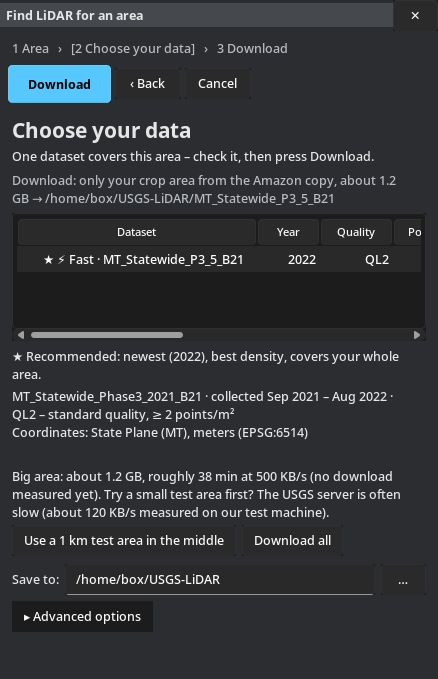

# Karttapullautin GUI – downloads

Karttapullautin GUI is a desktop app for Karttapullautin (pullauta), the tool that turns LiDAR point clouds into orienteering maps. Find free USGS LiDAR for your area or add your own `.laz`/`.las` files, crop to the area you want, press Start, and the app prepares the data, runs pullauta and shows you the map.

This version is built for the Americas (US, Canada, Latin America): LiDAR search, coordinate systems and defaults. A future version will work worldwide, including Europe, Russia, Japan, Australia and New Zealand.

This repository only hosts the ready-to-run downloads. Get them from the [Releases](../../releases/latest) page.

| Your computer | Download |
|---|---|
| Windows 10/11 (64-bit), installer (recommended) | `KarttapullautinGUI-<version>-Setup-x64.exe` |
| Windows 10/11 (64-bit), portable (no install) | `KarttapullautinGUI-<version>-windows-x64.zip` |
| Mac with Apple Silicon (M1, M2, M3, M4…) | `KarttapullautinGUI-<version>-macos-arm64.dmg` |
| Mac with an Intel processor | `KarttapullautinGUI-<version>-macos-intel.dmg` |
| Linux x86_64 (Ubuntu 22.04+ / Debian 12+) | `KarttapullautinGUI-<version>-linux-x86_64.tar.gz` |

## What it does

- **Find LiDAR:** draw your area on the map and the app lists the LiDAR that covers it: USGS in the US, NRCan in Canada and LidarBC in British Columbia. Where it can (⚡), it downloads only your area, fast.
- **Crop:** draw a box or a polygon, even before adding files, or use a park's outline plus a buffer. Only the points inside are used, and the map is blank outside your area and your data.
- **Map type:** Forest 1:10000, Forest 1:7500 or Sprint 1:4000 (ISOM / ISSprOM).
- **Lakes and ponds** are found in the LiDAR and shown in blue, with no contours on water.
- **Old LiDAR** with no ground points marked still makes a map: the app marks the ground itself.
- **Files with no location:** type the place name once, and the app finds the coordinate system that puts the files there.
- **Map:** reprojects to UTM meters, merges tiles, makes a hillshade and runs pullauta. You can watch the result on the built-in map.
- **Several projects:** one window per project (New window, Ctrl+N), listed under **Windows ▾**. **New project** starts over after asking.
- **Light or dark:** **Theme ▾** on the toolbar.

## First launch

- **Windows (installer):** run `KarttapullautinGUI-<version>-Setup-x64.exe`. By default it installs for your user only (no admin rights needed) and adds a Start-menu entry. Uninstall it from Apps & features. If the app is open, Setup closes it first.
- **Windows (portable):** unzip and run `KarttapullautinGUI.exe` from a folder you can write to.
- **macOS:** open the `.dmg` and drag `KarttapullautinGUI.app` to Applications.
- **Linux:** `tar xzf KarttapullautinGUI-*-linux-x86_64.tar.gz` and run `./KarttapullautinGUI`.

On first Start the app downloads the matching pullauta program automatically.

## Why does my computer warn me about this app?

Karttapullautin GUI is a free hobby project. Apple charges $99 a year and Windows code-signing services charge about $10 a month just to stamp an app as "checked", so I've chosen not to pay for that. The warning only means the app isn't signed, not that anything is wrong with it.

- **Mac:** the first time, right-click the app, choose **Open**, then **Open** again. On newer macOS, go to System Settings › Privacy & Security and click **Open Anyway**.
- **Windows:** if SmartScreen appears, click **More info**, then **Run anyway**.

## Feedback

In the app, **Feedback ▾ → Report a bug** or **Suggest a feature**, or use the [forms here](../../issues/new/choose). You need a free GitHub account.

## License

Free for personal, club, school and other non-commercial use under the [PolyForm Noncommercial License 1.0.0](https://polyformproject.org/licenses/noncommercial/1.0.0/). For commercial use, send a [Commercial use request](../../issues/new?template=commercial_use.yml).

pullauta (Karttapullautin) is a separate program under the GPL-3.0 ([source](https://github.com/karttapullautin/karttapullautin)).

More help is in the [wiki](../../wiki).
