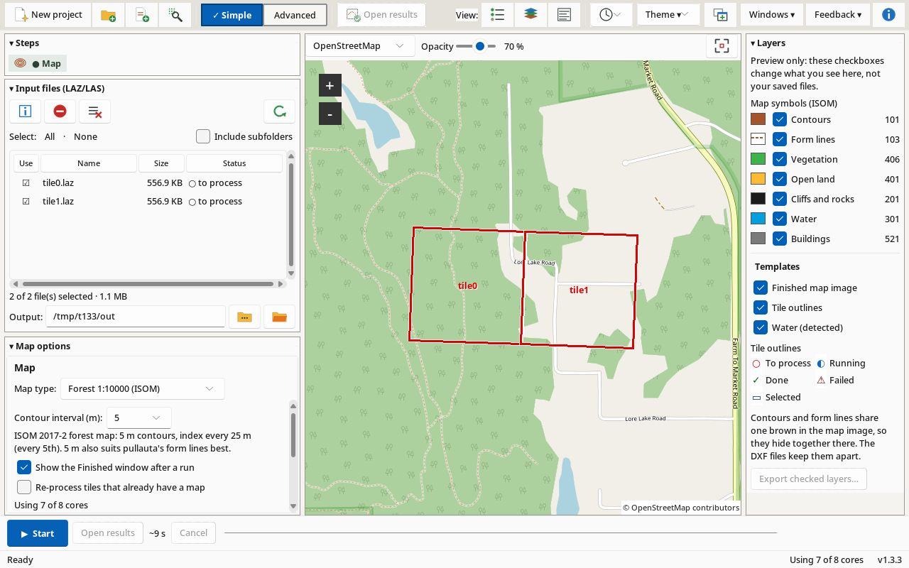
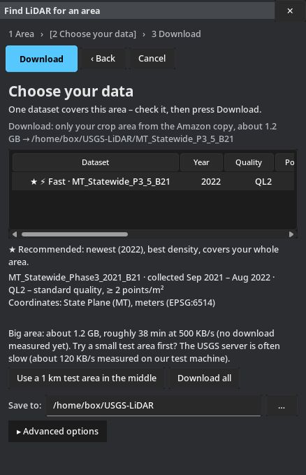

# LasGuide – downloads

## Download

- **Windows installer:** [LasGuide-Setup-x64.exe](https://github.com/wdickin/LasGuide-releases/releases/latest/download/LasGuide-Setup-x64.exe)
- **Windows zip:** [LasGuide-windows-x64.zip](https://github.com/wdickin/LasGuide-releases/releases/latest/download/LasGuide-windows-x64.zip)
- **Mac and Linux:** currently on 1.4.7. Get `LasGuide-macos-arm64.dmg` (Apple Silicon), `LasGuide-macos-x86_64.dmg` (Intel), or `LasGuide-v1.4.7-linux-x86_64` from the [v1.4.7 release](https://github.com/wdickin/LasGuide-releases/releases/tag/v1.4.7).

LasGuide is a free desktop app for Karttapullautin (pullauta), the tool that turns LiDAR point clouds into orienteering maps. Find free LiDAR for your area (United States, Canada, Finland and Sweden) or add your own `.laz`/`.las` files, crop to the area you want, press Start, and the app prepares the data, runs pullauta and saves a map you can open in OpenOrienteering Mapper.

This repository only hosts the ready-to-run downloads. Get them from the [Releases](../../releases/latest) page.

**Current version: [v1.4.9](../../releases/tag/v1.4.9)** (released 2026-11-11). Windows is on 1.4.9; Mac and Linux builds are on [v1.4.7](../../releases/tag/v1.4.7).

**What's new in 1.4.9:** On Windows, **Generate DEM** writes a GeoTIFF DTM and hillshade; **Build map file** also writes an OCAD 12 `.ocd` next to the `.omap`, with the title block and legend as real objects; large areas keep a clean joined elevation grid; update checks run at every start; **Open logs folder** sits beside Open results; Support LasGuide opens a PayPal Donate page, with a once-per-version prompt you can turn off. Mac and Linux stay on 1.4.7. Full list in the [release notes](../../releases/tag/v1.4.9).

| Your computer | Download |
|---|---|
| Windows 10/11 (64-bit), installer (recommended) | [`LasGuide-Setup-x64.exe`](https://github.com/wdickin/LasGuide-releases/releases/latest/download/LasGuide-Setup-x64.exe) (versioned: `LasGuide-v1.4.9-Setup-x64.exe`) |
| Windows 10/11 (64-bit), portable (no install) | [`LasGuide-windows-x64.zip`](https://github.com/wdickin/LasGuide-releases/releases/latest/download/LasGuide-windows-x64.zip) (versioned: `LasGuide-v1.4.9-windows-x64.zip`) |
| Mac with Apple Silicon (M1, M2, M3, M4…) – 1.4.7 | [`LasGuide-macos-arm64.dmg`](https://github.com/wdickin/LasGuide-releases/releases/download/v1.4.7/LasGuide-macos-arm64.dmg) |
| Mac with an Intel processor – 1.4.7 | [`LasGuide-macos-x86_64.dmg`](https://github.com/wdickin/LasGuide-releases/releases/download/v1.4.7/LasGuide-macos-x86_64.dmg) |
| Linux x86_64 (Ubuntu 22.04+ / Debian 12+) – 1.4.7 | [`LasGuide-v1.4.7-linux-x86_64`](https://github.com/wdickin/LasGuide-releases/releases/download/v1.4.7/LasGuide-v1.4.7-linux-x86_64) |

## What it does

- **Find LiDAR:** draw your area on the map and the app lists the LiDAR that covers it: USGS in the US, NRCan in Canada and LidarBC in British Columbia. Where it can (⚡), it downloads only your area, fast. **Files › Download European LiDAR…** covers Finland and Sweden.
- **Crop:** draw a box or a polygon, even before adding files, or use a park's outline plus a buffer. Only the points inside are used, and the map is blank outside your area and your data.
- **Map type:** Forest 1:10000, Forest 1:7500 or Sprint 1:4000 (ISOM / ISSprOM).
- **Lakes and ponds** are found in the LiDAR and shown in blue, with no contours on water.
- **Old LiDAR** with no ground points marked still makes a map: the app asks first, then marks the ground itself.
- **Files with no location:** type the place name once, and the app finds the coordinate system that puts the files there.
- **Map:** reprojects to UTM meters, merges tiles, makes a hillshade and runs pullauta. You can watch the result on the built-in map.
- **Big areas:** files bigger than 2.5 km on a side are split into blocks of about 2 × 2 km, mapped side by side and merged back into one map (`OUT/merged/`). A 10 × 10 km area took about 8 minutes on our 8-core test computer.
- **OpenOrienteering Mapper:** every run saves a georeferenced `.omap` on ISOM / ISSprOM symbols. **Files › Check file origin…** tells you whether an `.omap` was made by LasGuide and edited since.
- **Updates:** at start, LasGuide tells you when a newer version is out (at most once a day). On Windows, **Update now** downloads and runs the new installer (checked against SHA256SUMS.txt); if anything goes wrong it opens the download page. **Files › Check data sources…** shows which LiDAR download services your computer can reach.
- **Several projects:** one window per project (**View › New window**, Ctrl+N), listed under **View › Windows**. **Files › New project…** starts over after asking.
- **Light or dark:** **View › Theme**.

## First launch

- **Windows (installer):** run `LasGuide-Setup-x64.exe` (or `LasGuide-v1.4.9-Setup-x64.exe`). By default it installs for your user only (no admin rights needed) and adds a Start-menu entry. Uninstall it from Apps & features. If the app is open, Setup closes it first.
- **Windows (portable):** unzip `LasGuide-windows-x64.zip` and run `LasGuide.exe` from a folder you can write to.
- **macOS (1.4.7):** open the `.dmg` and drag `LasGuide.app` to Applications.
- **Linux (1.4.7):** download `LasGuide-v1.4.7-linux-x86_64`, mark it executable (`chmod +x`), and run it.

On first Start the app downloads the matching pullauta program automatically.

## Why does my computer warn me about this app?

LasGuide is a free hobby project. Apple charges $99 a year and Windows code-signing services charge about $10 a month just to stamp an app as "checked", so I've chosen not to pay for that. The warning only means the app isn't signed, not that anything is wrong with it.

- **Mac:** the first time, right-click the app, choose **Open**, then **Open** again. On newer macOS, go to System Settings › Privacy & Security and click **Open Anyway**.
- **Windows:** if SmartScreen appears, click **More info**, then **Run anyway**.

## Support

LasGuide is free for personal, club, school and other non-commercial use. Optional support helps fund bug fixes and new features: [Buy me a $5 coffee](https://paypal.me/wildterrainnav/5USD) (PayPal). In the app, use **SUPPORT LASGUIDE** (top right) or **Help › Support LasGuide…**.

## Feedback

In the app, **Help › Report a problem…** opens the bug form with the app version, Windows and the last step and last error filled in (file names, names and coordinates are taken out, and you see the form before anything is sent). **Help › Suggest a feature** opens the idea form. Or use the [forms here](../../issues/new/choose). You need a free GitHub account.

## License

Free for personal, club, school and other non-commercial use under the [PolyForm Noncommercial License 1.0.0](https://polyformproject.org/licenses/noncommercial/1.0.0). For commercial use, send a [Commercial use request](../../issues/new?template=commercial_use.yml).

pullauta (Karttapullautin) is a separate program under the GPL-3.0 ([source](https://github.com/karttapullautin/karttapullautin)).

More help is in the [wiki](../../wiki).
