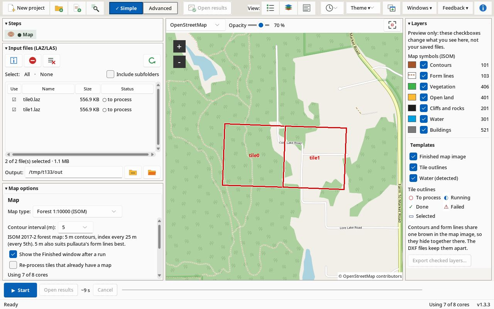

# Karttapullautin GUI

<p align="center">
  <a href="https://github.com/wdickin/karttapullautin-gui-releases/releases/latest"></a>
</p>
<p align="center">
  <a href="https://github.com/wdickin/karttapullautin-gui-releases/releases/latest"></a>
  <a href="https://github.com/wdickin/karttapullautin-gui-releases/releases/latest"></a>
  <a href="https://github.com/wdickin/karttapullautin-gui-releases/releases/latest"></a>
  <a href="https://github.com/wdickin/karttapullautin-gui-releases/releases/latest"></a>
  <a href="https://github.com/wdickin/karttapullautin-gui-releases/wiki/Version-History"></a>
</p>
<p align="center"><sub>macOS builds are unsigned: the first time, right-click the app → <b>Open</b>. Windows may show SmartScreen: <b>More info → Run anyway</b>. · <a href="https://github.com/wdickin/karttapullautin-gui-releases/wiki">Wiki</a> · <a href="https://github.com/wdickin/karttapullautin-gui-releases/wiki/FAQ">FAQ</a></sub></p>

<!-- The release asset names include the version (KarttapullautinGUI-v1.3.0-Setup-x64.exe), so every button links to
     /releases/latest. Once CI also uploads version-free names (e.g. KarttapullautinGUI-Setup-x64.exe), point each
     button at https://github.com/wdickin/karttapullautin-gui-releases/releases/latest/download/<name> so it downloads directly. -->

Desktop front-end for [Karttapullautin](https://github.com/karttapullautin/karttapullautin) (`pullauta`). It runs on Windows 10/11, macOS and Linux.
It runs the LiDAR workflow from **LAS-GUIDE V1** without LAStools:

**Info → Reproject to UTM → Merge → Clip → Hillshade → Map (pullauta)** (turn each step on or off)

plus a lasinfo-style **File info / CRS…** view and a live map preview. Pure Python: Tkinter, `laspy[lazrs]`, `pyproj`, `numpy`, `pillow`, `tkintermapview`, `requests`. It builds into one self-contained executable.



## Simple and Advanced mode

The **Simple | Advanced** switch at the top left changes how much of the app you see. It is saved in `settings.json`. The first launch opens in Simple.

| | Simple | Advanced |
|---|---|---|
| What runs | **Karttapullautin only**, on the ticked files | Info → Reproject → Merge → Clip → Hillshade → Map, each step optional |
| Settings shown | file list, output folder, Map tab (contour interval, form lines, pop-up, re-process; under *Show advanced options*: processes, DXF, open folder, verbose log, elevation/form-line settings, ini editor) | all tabs: Map (plus *Run pullauta*, alignment map, *Detect buildings*, *Only UTM* guard, *Copy prepared LAZ*), Reproject, Merge/Clip, Hillshade |
| Step strip | only the **Map** chip | all six chips (click one to jump to its tab) |
| Map preview | footprints + finished map overlays, basemap, opacity, Fit | also source footprints, hillshade layer, **Draw clip**, open in browser |
| Files that aren't UTM in meters | feet and lat/lon are reprojected to UTM in meters automatically; a header CRS that doesn't fit the data's location stops the run and offers the CRS that fits | strict guard (feet and lat/lon are blocked) or reprojection, with the same CRS check |

Both modes are the same program and use the same code paths. Switching only hides or shows controls; no setting is reset. Reprojection, hillshade and clip options you set in Advanced are kept but ignored while you're in Simple. Simple's automatic reprojection always uses built-in defaults (UTM zone per tile, ft→m for XY and Z).

## Main window

- **Left panel** (collapse it with **◂ Panel**): the input file list and the settings tabs.
- **Map preview** (right): OpenStreetMap, Esri satellite, OpenTopoMap, Esri topo, or *Blank (offline)*. Each tile's footprint is a bold outline with a white edge, so it shows on every basemap: red = idle/waiting, gray dashed and hatched = unticked, blue = running, green = done, dark red and hatched = failed, brown dashed = skipped. The clip area is a red dashed box. Finished pullauta maps (and hillshades in Advanced) are warped to Web Mercator in a background thread and drawn over the basemap. Use **Layers ▾** and **Opacity** to change what you see. Click a tile for its info (CRS, points, outputs, open the PNG or folder). The selection follows between the list and the map. With no internet the map switches to the blank background and keeps working. Tiles are cached in the app data folder (`tile_cache/`).
- **Step strip** (top): every step has a chip showing off / waiting / running / done / failed and a count.
- **Log drawer** (**Log ▴/▾**) at the bottom. It starts collapsed on short screens such as 1366×768 at 125 %.
- **Clip dialog** (Advanced only: **Draw clip area on map…** on the Merge/Clip tab, *Draw clip* in the map toolbar, or right-drag on the main map): draw a rectangle on the map. W/S/E/N are filled in the CRS the clip runs in (the UTM target when reprojection is on). The dialog shows width × height, area, and an estimate of the points kept, and has inside/outside and *Full extent*. **OK** writes the values to the Clip tab.

## Usage

1. Start `KarttapullautinGUI.exe` / `KarttapullautinGUI.app` / `KarttapullautinGUI` (or `python karttapullautin_gui.py`).
2. **Input files**: the list in the main window shows every `.laz`/`.las` file you added. Extensions in any case work (`.LAZ`/`.LAS` too). Columns: name, size, modified date, status and folder.
   - **Add folder…** adds all LAS/LAZ files in a folder. Tick *include subfolders* first to search below it. The Windows folder dialog never shows files; that's normal, and the files appear in the list afterwards.
   - **Add files…** lets you pick one or more files (Ctrl/Shift-click) from any folder. Files from several folders can be mixed.
   - Click the **Use** box (or press Space on the selected rows) to include or exclude a file. **All / None**, **Remove** (removes the selected rows; the Del key works too), **Clear**, and **Refresh** are next to the list.
   - The list refreshes itself when a folder changes, and is saved in `settings.json`. The line under it shows how many files are selected, their total size, and how many already have an output PNG. **Start** is grayed out when nothing is ticked.
   - Only ticked files are processed. They are hard-linked (same drive) or copied (another drive) into `work\input` with a lowercase extension, because pullauta only reads lowercase `.laz/.las`. Your originals are never renamed or changed. Two files with the same name from different folders get the folder name as a prefix (e.g. `folderB_tile.laz`), and the Status column shows the new name.
   **Output folder**: where results go (defaults to `<first input folder>\out`).
3. **File info / CRS…** shows, for each tile: points, LAS version, bbox, CRS/EPSG and where it came from (WKT VLR, GeoTIFF keys, or your fallback), XY unit, Z factor to meters, center lat/lon, suggested UTM zone, and whether the tile is pullauta-ready. It also has *Count point classes* (a quick pass over the points that shows class counts and whether ground class 2 exists), *Show centre in OpenStreetMap*, and in Advanced mode also *Use extent for clip*, *Draw clip area on map…* and *Check alignment* (a Leaflet HTML page with source/UTM footprints, hillshades and maps over OSM or satellite).
4. In Simple mode just press **Start**. In Advanced mode, pick the steps you want in the tabs first. Each step runs in the background with a progress bar, and **Cancel** works at any point.

### 1 · Reproject to UTM
- **Source CRS** is read from the file header. Supported: OGC WKT VLRs (`LASF_Projection`, and the old `liblas` 2112 variant used by e.g. autzen.laz), EPSG GeoTIFF keys, vertical CRS keys, and *user-defined* GeoTIFF projections (raw parameters for TM, LCC 1SP/2SP, Albers, LAEA, Mercator, oblique stereographic and Cassini, or an EPSG conversion code). That last kind is common in US ArcGIS/LP360 exports. The datum is taken from the key or the citation text (NAD83(HARN)/(2011)/NAD83/NAD27/WGS84/ETRS89/GDA). The result is matched to an EPSG code when it is identical (e.g. EPSG:3361), and a NAVD88 vertical citation becomes EPSG:5703/8228/6360. If a file has none, pick a **Source CRS** (presets or any `EPSG:xxxx`, `EPSG:h+v`, WKT or PROJ string). **Override file CRS** forces it.
- **Target**: the UTM zone comes from the tile center (via pyproj), including the Norway 32V and Svalbard exceptions. *Auto – one zone for batch* (default) keeps neighboring tiles in one CRS. *Per tile* and *Force zone* are also available. Datum: *Auto* gives ETRS89 (`258xx`) in Europe and WGS84 (`326xx`/`327xx`) elsewhere. Either can be forced.
- **Units**: XY in ft/ftUS becomes meters through the projection. **Z** is scaled to meters from the vertical CRS unit (US ft 0.3048006096, ft 0.3048), or from the GeoTIFF vertical-unit key. If the file has no vertical CRS, Z is assumed to use the XY unit (checkbox, on by default, which is right for most US data).
- A compound source (e.g. `EPSG:6557+6360`, Oregon Lambert ft + NAVD88 ftUS) becomes compound UTM + the same vertical datum in meters (e.g. `EPSG:32610 + EPSG:5703`).
- Output: `work\prep\utm\<tile>.laz`, LAS 1.4, same point format and attributes, the new CRS as an OGC WKT VLR, offsets rounded to 1 km, scale 0.01 m (or 0.001). Originals are never touched. pullauta then reads from this folder.
- **Engine**: built-in pyproj (always available). If `pdal` is on PATH and *Use PDAL* is ticked, the same pipeline runs in PDAL (readers.las → filters.transformation for Z → filters.reprojection → writers.las), falling back to pyproj if PDAL fails. Both engines gave the same coordinates in testing (0–14 mm, i.e. rounding).
- **PROJ network grids**: without grid files, some datum shifts are approximate (OSGB36→ETRS89 is about 1.75 m off without OSTN15). Ticking this lets PROJ download the exact grids from cdn.proj.org. The log warns when a better grid exists.

### 2–3 · Merge / Clip
- **Merge** joins all (reprojected) tiles into `merged_<id>.laz`. All tiles must share a horizontal CRS, so reproject first.
- **Clip** keeps points inside (or outside) West/South/East/North, given in the CRS *after* step 1. **Fill from data** fills in the combined extent.
- pullauta skips a tile when `<name>.png` already exists. The merged/clipped file name contains a short id of the inputs and extent, so a new extent gets re-processed.

### 4 · Hillshade
Ground points (class 2) go into a DEM, using the lowest point per cell if the file has no ground class. Holes are filled, then the hillshade is drawn: classic NW 315°/45°, or multidirectional (225/270/315/360° blended). Output goes to `<output>\hillshade\<tile>_hillshade.png` + `.pgw` world file + `.prj`. Load it in OpenOrienteering Mapper as a georeferenced template.

### 5 · pullauta
Batch mode with your tuned ini (**Edit ini…** under *Show advanced options* on the Map tab). **Only run on UTM in metres** is the guard from LAS-GUIDE: files in feet or lat/lon are blocked, a known metric grid (e.g. ETRS-TM35FIN or a metric State Plane zone) runs without asking, and an unknown CRS asks first. With *Run pullauta* off, the prepared LAZ files are copied to `<output>\prepared_laz`.

Output per tile: `NAME.png`/`NAME_depr.png` (+`.pgw`) and DXF vectors (`_contours`, `_c2g`, `_c3g`, `_dotknolls`, `_formlines`…) as `.dxf` (with *Write plain .dxf*) and `.dxf.bin`.

### Notes / limits
- Z is only scaled for units. It is **not** transformed between vertical datums (e.g. N2000↔EVRF, NAVD88→ellipsoidal). Contours keep the source height datum, which is what you want for maps.
- pullauta only picks up lowercase `.laz`/`.las`, and names outputs after the file name. The GUI takes care of both by staging the selected files under unique, lowercase names.
- Paths go into the ini with `/` (pullauta's ini parser treats `\` as an escape). Paths can't contain `#` or `;`.
- `renderpng*` keys are ignored by pullauta v2.15.x. PNGs are always written.

### Where files live
Next to the exe if that folder is writable. Otherwise in the per-user app data folder: `%LOCALAPPDATA%\KarttapullautinGUI` (Windows), `~/Library/Application Support/KarttapullautinGUI` (macOS), or `$XDG_DATA_HOME` / `~/.local/share/KarttapullautinGUI` (Linux). The map tile cache always lives in that per-user folder, never inside the PyInstaller temp dir. Contents: `pullauta.exe`, `pullauta_version.txt`, `pullauta_base.ini`, `settings.json`, and `work\` (pullauta temp files, `work\input\` for the staged selection (hard links or copies), and `work\prep\` for reprojected/merged LAZ). `work\` can get big, so clear it from **Open work folder**.

## FAQ

Short answers. The full list is in the [wiki FAQ](https://github.com/wdickin/karttapullautin-gui-releases/wiki/FAQ).

**My data is in feet (US State Plane). Do I need to convert it?**
No. Simple mode reprojects feet and lat/lon files to UTM in meters automatically. In Advanced, keep *Reproject to UTM before processing* on (the default). [More](https://github.com/wdickin/karttapullautin-gui-releases/wiki/US-State-Plane-Data)

**My tile lands in the ocean or the wrong state.**
The file header has the wrong CRS (for example meters where the data is in US feet). Press **Start**: the *CRS check* offers **Use EPSG:xxxx**, so click it. Or set *Source CRS* + *Override file CRS* on the Reproject tab. [More](https://github.com/wdickin/karttapullautin-gui-releases/wiki/FAQ#my-tile-shows-up-in-the-ocean-or-the-wrong-state-whats-wrong)

**macOS says "unidentified developer" / "can't be opened".**
The builds aren't signed or notarized. Right-click the app → **Open** → **Open** the first time, or use System Settings → Privacy & Security → **Open Anyway**. [More](https://github.com/wdickin/karttapullautin-gui-releases/wiki/FAQ#macos-says-the-app-is-from-an-unidentified-developer-or-cant-be-opened)

**Windows SmartScreen blocks the installer.**
The app isn't code-signed yet. Click **More info → Run anyway**. [More](https://github.com/wdickin/karttapullautin-gui-releases/wiki/FAQ#windows-smartscreen-says-windows-protected-your-pc)

**Where are the logs?**
**About** shows the log file path, **Open log folder** and **Copy diagnostics**. The file is `logs/karttapullautin-gui.log` in the per-user data folder (Windows `%LOCALAPPDATA%\KarttapullautinGUI`). [More](https://github.com/wdickin/karttapullautin-gui-releases/wiki/FAQ#where-are-the-logs)

**Can it do a 10 × 10 km area?**
Yes. Add all the tiles and leave Merge off. pullauta runs tile by tile, writes one PNG + DXF set per tile, and skips finished tiles if you restart. [More](https://github.com/wdickin/karttapullautin-gui-releases/wiki/FAQ#can-it-do-a-10--10-km-area)

**Which scale and contour interval for orienteering?**
Start with 5 m contours and *Form lines: Normal*. pullauta's form lines are tuned for 5 m. The app doesn't set a map scale. You choose 1:10 000, 1:7 500 or 1:4 000 (sprint) when you draw the map in OCAD or OpenOrienteering Mapper. [More](https://github.com/wdickin/karttapullautin-gui-releases/wiki/FAQ#which-scale-and-contour-interval-should-i-use-for-orienteering)

## Build the Windows .exe

Requirements: Windows 10/11 x64 and Python 3.10+ from python.org (Tcl/Tk is included by default). The exe it builds needs nothing installed on the target PC: no Python, no PDAL, no VC++ redistributable (PyInstaller bundles the runtime DLLs), and no admin rights.

```bat
build_windows.bat            :: downloads pullauta on first start
build_windows.bat bundle     :: also embeds pullauta.exe (works offline)
```
The script creates a clean `.venv`, installs `requirements.txt` as binary wheels only, and runs `pyinstaller --noconfirm --clean KarttapullautinGUI.spec`. Result: `dist\KarttapullautinGUI.exe`. If `app.ico` exists, it's used as the icon.

`KarttapullautinGUI.spec` is shared by all three OSes:
- One file on Windows and Linux, a `.app` bundle on macOS.
- The PROJ database is bundled (`proj.db`, ≈10 MB) but no datum-shift grids. Grids can be downloaded at run time with *PROJ network grids*.
- Heavy unused modules are excluded (matplotlib, scipy, pandas, IPython, Qt, tests…).
- Hidden imports for `lazrs`, `tkintermapview` and `PIL._tkinter_finder`.
- Environment switches: `KP_BUNDLE_PULLAUTA=1` (embed `bin/pullauta[.exe]`), `KP_UPX=1` (UPX compression; off by default because it triggers more antivirus false positives), `KP_TARGET_ARCH` (macOS).
- Measured size: **50 MB** for the Linux one-file binary (not stripped: `strip` breaks numpy's OpenBLAS with older binutils) (PyInstaller 6.22, Python 3.13). Windows is about the same.

pullauta lookup order: a copy next to the app or in the app data folder, then the bundled `bin/` copy, then `PATH`. If none is found, the matching release asset is downloaded on first start.

**Self-check**: the first log lines show the app version, Python, OS, the library versions (laspy, lazrs, pyproj/PROJ, numpy, Pillow, tkintermapview, Tk), the PROJ data folder and `proj.db` status, and the LAZ backends. `KP_SELFTEST=1 KarttapullautinGUI` runs headless: it writes a small LAZ in EPSG:3067, reprojects it, writes `selftest.txt` and exits 0 (pass) or 1. CI uses this.

**Antivirus/SmartScreen**: unsigned one-file exes are sometimes flagged. A `--onedir` build or code-signing helps.

## Building for macOS and Linux

### macOS
```sh
./build_macos.sh            # .app for this Mac's architecture + zip
./build_macos.sh bundle     # also embed pullauta
KP_TARGET_ARCH=universal2 ./build_macos.sh   # needs a universal2 python.org Python and universal wheels
```
- Python 3.10+ from python.org (its Tk 8.6 works; avoid Apple's system Python). Result: `dist/KarttapullautinGUI.app`, plus a zip made with `ditto` and optionally a `.dmg` (`hdiutil`, see the script).
- **Apple Silicon vs Intel**: build on each, or use universal2. pullauta ships `arm64-macos` and `x86_64-macos` builds, and the app downloads the right one.
- **Gatekeeper**: the app isn't signed or notarized. On first start, right-click → Open, or run `xattr -dr com.apple.quarantine KarttapullautinGUI.app`. The app removes the quarantine flag from the pullauta binary it downloads.
- The ttk theme is `aqua`; the right mouse button is Button-2 / Ctrl-click.

### Linux
```sh
sudo apt install python3-venv python3-tk     # Debian/Ubuntu
./build_linux.sh            # dist/KarttapullautinGUI (one file)
./build_linux.sh bundle     # also embed pullauta
```
- The binary runs on systems with the same or newer **glibc** than the build machine. Build on the oldest distro you want to support (CI uses Ubuntu 22.04, glibc 2.35).
- It needs an X11/Wayland desktop with the usual X libs. Tk is bundled.
- For a desktop-integrated package, wrap `dist/KarttapullautinGUI` in an **AppImage** (see the notes in `build_linux.sh`).
- Files open with `xdg-open`.

### GitHub Actions
`.github/workflows/build.yml` builds on `windows-latest`, `macos-14` (arm64), `macos-15-intel` (x86_64) and `ubuntu-22.04`. Each job runs pyflakes, builds from the spec, runs the `KP_SELFTEST` smoke test, and uploads the artifacts `KarttapullautinGUI-windows-x64`, `KarttapullautinGUI-macos-arm64`, `KarttapullautinGUI-macos-x86_64` and `KarttapullautinGUI-linux-x86_64`.

## Run from source (any OS)
```
pip install -r requirements.txt
python karttapullautin_gui.py
```
On Linux you also need `python3-tk`. The matching pullauta build is downloaded automatically.

## Progress, About and tests

- The bottom bar shows the current step in plain words (e.g. *Reprojecting tile 2 of 5 · 3.0 M / 9.8 M points*, *Pullauta: tile 3/8 done, 2 running*), percent or tiles done, elapsed time and a rough time left. It only pulses when there is nothing to measure yet (pullauta before its first tile finishes).
- **About** (top right, or the app menu on macOS) shows the version, copyright and credits/licenses.
- Basemap tiles are fetched politely (identifying User-Agent, at most 4 parallel requests per tile service, OpenTopoMap a/b/c servers, retries with backoff; throttled tiles are retried instead of left blank) and cached on disk.
- Tests: `xvfb-run -a python -m pytest -q tests` (Linux; on Windows/macOS just `python -m pytest -q tests`). CI runs them on Linux before building.
- **Recent ▾** (top right) reopens one of your last 10 projects (inputs, output folder, mode, CRS choices) with one click; the list lives in `recent_projects.json` in your user config folder (`%APPDATA%\KarttapullautinGUI`, `~/Library/Application Support/KarttapullautinGUI` or `~/.config/KarttapullautinGUI`). Projects whose files are gone drop out; *Clear list* empties it.
- The look follows your system light/dark setting (Sun Valley theme via sv-ttk). Set `KP_THEME=light` or `KP_THEME=dark` to force one.
- **Windows installer:** `KarttapullautinGUI-Setup-x64.exe` installs per user (no admin) into `%LOCALAPPDATA%\Programs\Karttapullautin GUI` with a Start-menu entry, optional desktop icon and optional `.laz`/`.las` association (off by default); uninstall from *Apps & features*. The portable `.exe` still works as before.
